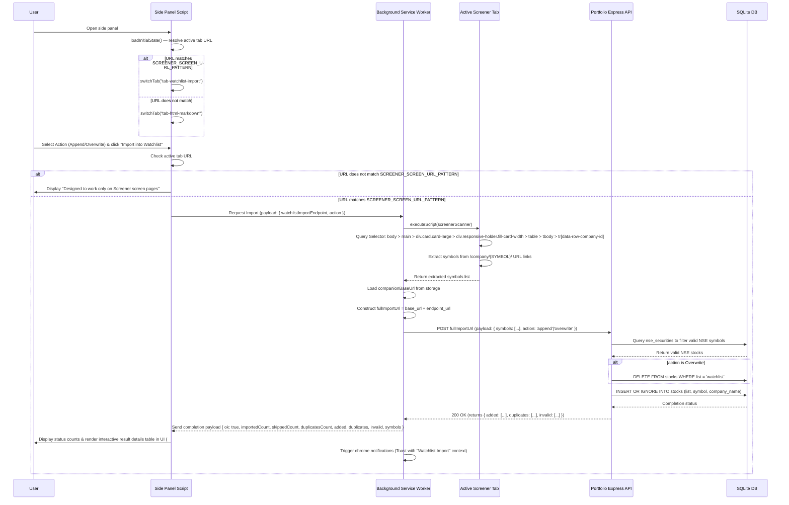

# Import Screened Companies to Watchlist

## 🎯 Scope

Provides a mechanism for users to manually trigger the import of screened companies from a webpage into their watchlist. The action is triggered via an **"Import into Watchlist"** button located in the **Watchlist Import** tab of the extension's side panel UI. When clicked:

1. The extension checks if the active tab's URL matches `SCREENER_SCREEN_URL_PATTERN`.
2. If it does not match, the extension shows an informative message: "This feature is designed to work only on URLs matching the `https://www.screener.in/screens/*` pattern."
3. If it matches, the side panel script requests the Background Service Worker to orchestrate the import, passing the `watchlistImportEndpoint` setting and chosen action (append or overwrite).
4. The Background Service Worker runs a DOM scanner query on the active tab for target `tr[data-row-company-id]` table rows to extract company symbols, combines the storage-cached `companionBaseUrl` and `watchlistImportEndpoint` settings into `fullImportUrl`, and completes both stock validation and database commits in a single bulk API request (`POST fullImportUrl`) before notifying the side panel.

**Repeated Values:**

- `companionBaseUrl`: The base URL of the server hosting the companion app's APIs (configured in the existing options UI settings).
- `watchlistImportEndpoint`: The relative URL path for the watchlist import endpoint (default: `/api/portfolio-watchlist/import-from-screener`).
- `fullImportUrl`: The constructed destination address for the API request: `companionBaseUrl + watchlistImportEndpoint`.
- `SCREENER_SCREEN_URL_PATTERN`: The URL pattern matching Screener screens: `https://www.screener.in/screens/*`.

**In scope:**

- A **tabbed side panel UI** with two tabs: **HTML → MD** and **Watchlist Import**. Each tab contains its own heading, description, and feature content. On panel load, the active tab auto-selects based on the current page URL: if it matches `SCREENER_SCREEN_URL_PATTERN`, the **Watchlist Import** tab opens by default; otherwise, the **HTML → MD** tab opens.
- Exposing a configurable input text field for `watchlistImportEndpoint` directly inside the Watchlist Import tab (under a collapsible settings `
` container, defaulting to `/api/portfolio-watchlist/import-from-screener`).
- An "Import into Watchlist" action button inside the Watchlist Import tab panel.
- URL-validation check that alerts the user if the active tab is not a matching Screener screen URL.
- Visual DOM selector parser running in the active tab to scrape company tickers/symbols specifically from target `tr` rows under the query chain `body > main > div.card.card-large > div.responsive-holder.fill-card-width > table > tbody > tr` that carry the `data-row-company-id` attribute.
- A toggle/radio selection option in the Watchlist Import tab letting the user choose between appending to or overwriting the existing watchlist *before* initiating the action.
- Single unified API call (`POST fullImportUrl`) triggered by the Background Service Worker executing both validation and import actions on the server.
- Toast notifications for reporting the success or failure of the import run.

**Non-goals:**

- Automatic background detection of the Screener webpage without manual trigger.
- Direct local database queries from the Chrome extension (must go through the portfolio application APIs).
- Support for BSE-only tickers or unlisted tickers.

---

## 🏗️ Design

### End-to-End Import Flow

---

## 📋 Implementation Map

### Chrome Extension (Chromium Utilities)

| Path | Action | Purpose |
| ------ | -------- | --------- |
| `src/core/storage.js` | **modified** | Update default settings object to include `watchlistImportEndpoint` initialized to its default endpoint path. |
| `src/content-scripts/screener-scanner.js` | **added** | Content script that queries `body > main > div.card.card-large > div.responsive-holder.fill-card-width > table > tbody > tr[data-row-company-id]` to extract symbol tokens from link hrefs (matching `/company/(.+)/`). Exposed as `window.__SCREENER_SCAN`. |
| `src/background/service-worker.js` | **modified** | Handles `import-watchlist` message: injects `screener-scanner.js` via `chrome.scripting.executeScript`, invokes `window.__SCREENER_SCAN()`, loads `companionBaseUrl` from storage, constructs `fullImportUrl`, dispatches the POST request with `{ symbols, action }`, manages keep-alive heartbeats, fires `chrome.notifications` (with `contextMessage` "Watchlist Import"), and sends the result back to the side panel including status-specific array categorizations (`added`, `duplicates`, `invalid`, `symbols`). Also updated `showNotification()` to accept an optional `contextMessage` parameter. |
| `src/app/sidepanel/sidepanel.html` | **modified** | Restructured into a **tabbed layout** with `<nav class="tabs-header">` containing two tab buttons (`HTML → MD` and `Watchlist Import`). Each tab has a corresponding `
` with its own `<header>` (title + description). The Watchlist Import panel contains append/overwrite radio options, an "Import into Watchlist" button, a collapsible `
` settings section with the `watchlistImportEndpoint` input, a status message area, and a `#import-results-container` to render detailed results. Page title changed to "Chromium Utilities". |
| `src/app/sidepanel/sidepanel.js` | **modified** | Added `switchTab(tabId)` function to toggle tab visibility, tab button click handlers in `bindEvents()`, and URL-based auto-tab-selection in `loadInitialState()` (if active tab URL matches `SCREENER_SCREEN_URL_PATTERN`, auto-switches to "Watchlist Import" tab). Added `handleWatchlistImport()` (validates URL, reads action radio & endpoint, dispatches `import-watchlist` message), `saveWatchlistEndpoint()` (persists to `chrome.storage.sync`), `setWatchlistStatus()` helper, and `renderImportResults()` to construct an interactive table displaying the import status of each captured stock. |
| `src/app/sidepanel/sidepanel.css` | **modified** | Added `.tabs-header`, `.tab-button` (with active state border styling), `.tab-panel` (hidden by default, shown when `.active`), `.watchlist-section`, `.watchlist-controls`, `.radio-group`, `.watchlist-settings`, and `.watchlist-status` (with `.error`, `.success`, `.info` color variants) styles. Added styling for `.import-results-container`, `.import-table`, and status label classes (`.status-added`, `.status-duplicate`, `.status-invalid`). |

### Watchlist Application (shagun-agent)

| Path | Action | Purpose |
| ------ | -------- | --------- |
| `server/db/stocks.js` | **modified** | Implement the `importWatchlistFromScreener(symbols, action)` function, which validates symbols, clears the watchlist (for overwrite), inserts valid NSE stocks, and returns lists (`added`, `duplicates`, and `invalid`) along with metrics summary (`importedCount`, `skippedCount`) representing the outcomes of checked symbols inside a SQLite transaction. |
| `server/routes/nseStocksRoute.js` | **modified** | Expose and export a named route controller function `importFromScreener(req, res)` that validates target payload structure and delegates to the database controller. |
| `server/server.js` | **modified** | Import `importFromScreener` from the stocks route file and register `POST /api/portfolio-watchlist/import-from-screener` on the Express API router. |

---

## 🔑 Key Decisions

| Decision | Choice | Trade-off / Why not the alternative |
| ---------- | -------- | -------------------------------------- |
| **Side Panel Layout** | Tabbed UI with auto-selection based on active tab URL | **Alternative:** Single-pane layout with both features vertically stacked, separated by an `
` divider. **Why not:** Tabs cleanly isolate features, reduce visual clutter, and the auto-tab-selection provides natural context — if the user is on a Screener page, the Watchlist tab opens automatically; otherwise, the HTML→MD tab takes precedence. |
| **API Endpoints Construction** | Expose user-configurable relative `watchlistImportEndpoint` settings input inside a details drawer in the Watchlist Import tab | **Alternative:** Expose the relative endpoint path on the main extensions options screen. **Why not:** The relative URL setting governs features isolation, only altering the watchlist import action; putting it inside the tab's collapsible settings keeps config details contextual and options neat. |
| **POST Request Executor** | Execute the import POST fetch call from the Background Service Worker | **Alternative:** Launch the POST fetch request directly from sidepanel.js. **Why not:** Exiting or closing the Chrome side panel element mid-process would kill the fetch script execution. Offloading to the background worker guarantees completion, permits keep-alive resets, and lets background toast announcements execute continuously. |
| **Consolidated API Endpoint** | Single atomic endpoint route (`fullImportUrl`) | **Alternative:** Making independent verify and import API calls. **Why not:** Reduces network request round-trips, avoids client-side complexity, and ensures that validation and database modifications happen in a single transaction context. |
| **Locator Parsing Precision** | Query rows matching custom table chain selector with `[data-row-company-id]` | **Alternative:** Parsing all anchor links on the page. **Why not:** Limits extraction to the screener results table only, avoiding links in headers, sidebars, charts, or other page widgets. |
| **User Prompting Method** | In-panel Radio selection elements | **Alternative:** standard Browser dialog (`window.confirm`). **Why not:** A side-panel option maintains a fluid sidebar experience and allows displaying stock stats dynamically without interrupting the workflow. |

---

## 📚 References

- [Companion Watchlist Import Plan](../../D:/Tutorials/Javascript/shagun-agent/plans/import-screener-watchlist/plan.md)
